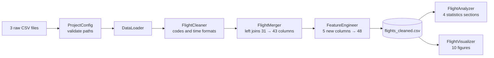
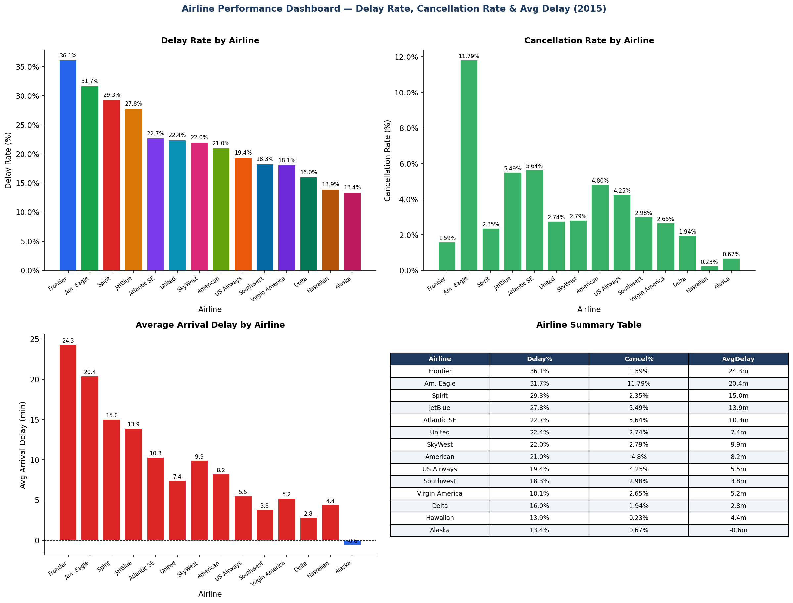
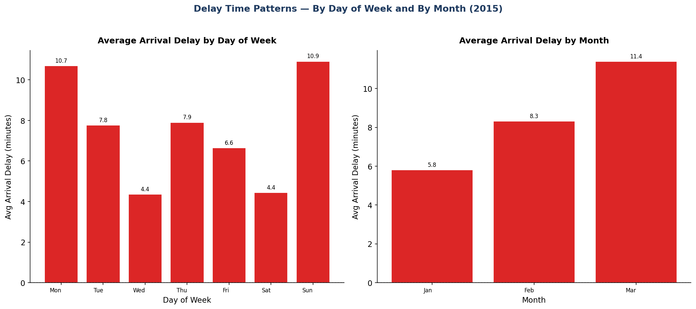
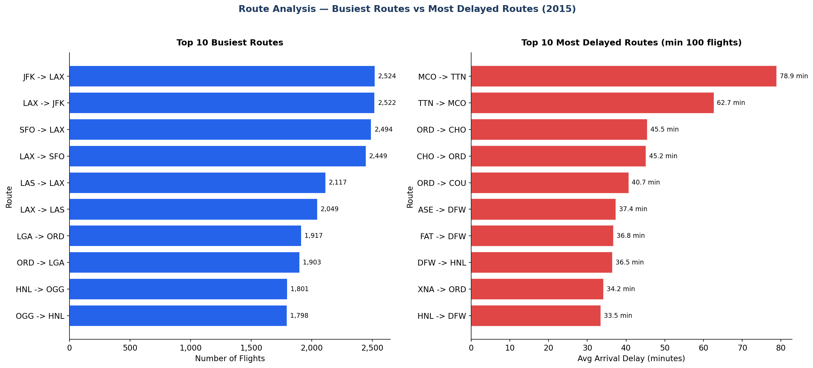
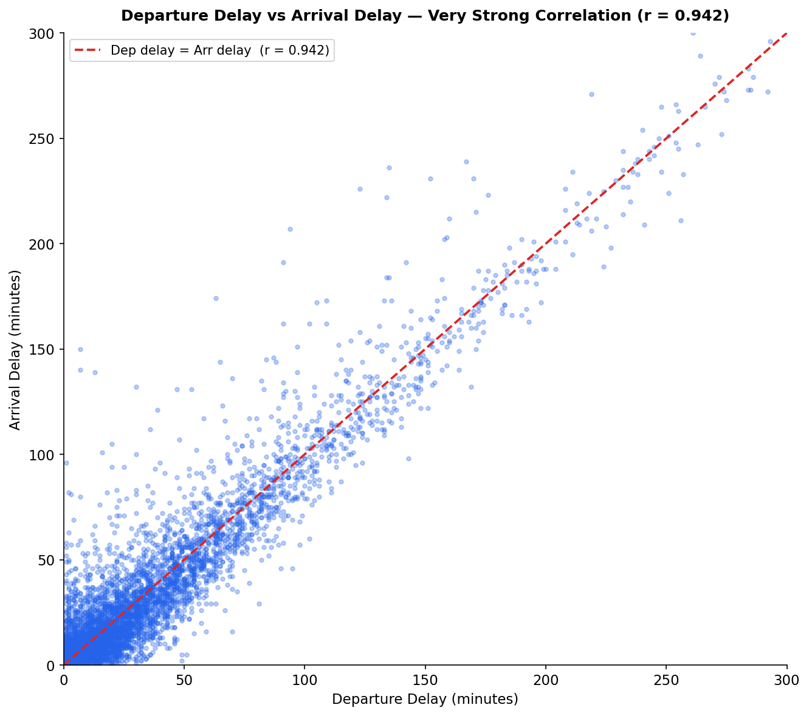

<!--
Repo settings to fill in on GitHub (About panel, gear icon):
Description: Object-oriented Python pipeline that cleans, merges and analyzes 1M+ US flight records to find delay patterns by airline, route and time.
Topics: python, data-pipeline, etl, pandas, oop, data-analysis, data-visualization, flight-delays, statistics
Delete this comment before committing.
-->

# Flight Data Pipeline: US Flight Delays and Cancellations


A modular, object-oriented Python pipeline that loads, cleans, merges and analyzes **1,048,575 US domestic flight records** (January–March 2015) to find which airlines, routes, days and months have the worst delays and cancellations. The full run produces a 48-column analysis-ready dataset, four sections of statistics and 10 figures in about **24 seconds** on a laptop.

Final project for DATA 2402 (Python Programming for Real-World Data), Mount Royal University, March 2026.

## Key findings

- **21.0%** of flights arrived more than 15 minutes late, but the **median** arrival delay was **-3 minutes**: most flights arrive early, and a small number of extreme delays (up to 1,971 minutes) pull the mean up to 7.6 minutes.
- **Frontier Airlines** was the least punctual (36.1% delayed, 24.3 minutes average); **Alaska Airlines** was the most punctual (13.4% delayed, arriving 0.6 minutes early on average).
- **Sunday and Monday** were the worst days to fly (about 11 minutes average delay); Wednesday and Saturday were the best (about 4.4 minutes).
- Departure delay almost fully explains arrival delay (Pearson **r = 0.942**): flights rarely make up lost time in the air.
- **3.86%** of flights were cancelled, mostly because of weather; **American Eagle** had the highest cancellation rate (11.79%).

## Problem

Flight delays cost passengers and airlines time and money, but the raw data is large, inconsistent and spread across several tables. This project answers:

1. Which airlines have the highest delay and cancellation rates?
2. Which routes are delayed most often?
3. How do delays change by day of week and by month?
4. How are delays distributed, and how should extreme values be handled?

## Data

| File | Description | Rows | Columns |
| --- | --- | --- | --- |
| `flights.csv` | US domestic flight records, January–March 2015 | 1,048,575 | 31 |
| `airports.csv` | Airport reference data (code, city, state, latitude, longitude) | 322 | 7 |
| `airlines.csv` | Airline reference data (IATA code, name) | 14 | 2 |

**Source:** [2015 Flight Delays and Cancellations](https://www.kaggle.com/datasets/usdot/flight-delays) (Kaggle, from the U.S. Department of Transportation). This project uses the first 1,048,575 records of the full file.

The full `flights.csv` (about 107 MB) is too large for GitHub, so this repo includes `data/flights_sample.csv` (10,000 rows) for testing. See [How to run](#how-to-run).

**Data problems solved:**

- Inconsistent airport codes across tables (`" jfk "`, `"Jfk"`, `"JFK"`)
- Times stored as HHMM integers (`2354` → `23:54`)
- Missing values that are expected for cancelled and diverted flights (kept as missing, not filled)
- 89,544 arrival-delay outliers (8.9%) found with the IQR method and kept, because they are real events
- Mixed data types that needed explicit numeric conversion

## Pipeline architecture



| Class | File | Responsibility |
| --- | --- | --- |
| `ProjectConfig` | `config.py` | Frozen dataclass holding paths and constants; checks input files exist |
| `DataLoader` | `loader.py` | Reads the three CSV files |
| `FlightCleaner` | `cleaner.py` | Standardizes codes, converts time formats, reports missing values |
| `FlightMerger` | `merger.py` | Left joins airlines and airports, reports unmatched rows |
| `FeatureEngineer` | `features.py` | Adds `IS_CANCELLED`, `IS_DIVERTED`, `IS_DELAYED`, `DELAY_CATEGORY`, `ROUTE` |
| `FlightDataPipeline` | `pipeline.py` | Runs the six steps in order and times each one |
| `FlightAnalyzer` | `analyzer.py` | Summary statistics, group-wise analysis, correlation, outliers |
| `FlightVisualizer` | `visualizer.py` | Builds and saves the 10 figures |

Design principles: single responsibility per class, no repeated code (shared chart builders), immutable configuration, and validation before any heavy work starts.

## Project structure

```text
flight-data-pipeline/
├── data/
│   ├── airlines.csv
│   ├── airports.csv
│   └── flights_sample.csv      # 10,000-row sample; full flights.csv not tracked
├── Outputs/
│   └── figures/                # 10 PNG figures
├── src/
│   ├── __init__.py
│   ├── config.py
│   ├── loader.py
│   ├── cleaner.py
│   ├── merger.py
│   ├── features.py
│   ├── pipeline.py
│   ├── analyzer.py
│   ├── visualizer.py
│   └── main.py
├── requirements.txt
├── .gitignore
├── LICENSE
└── README.md
```

## How to run

```bash
# 1. Clone the repo
git clone https://github.com/habenTesfamichael/flight-data-pipeline.git
cd flight-data-pipeline

# 2. Create a virtual environment and install packages
python -m venv venv
venv\Scripts\activate            # macOS/Linux: source venv/bin/activate
pip install -r requirements.txt

# 3. Add the flight data (choose one)
#    a) Quick test: copy data/flights_sample.csv to data/flights.csv
#    b) Full run: download flights.csv from the Kaggle link above into data/

# 4. Run from the project root (the -m flag is required for the imports)
python -m src.main
```

Outputs: `outputs/flights_cleaned.csv`, 10 figures in `outputs/figures/`, and the statistics printed in the terminal.

## Results

### Airline performance



Frontier Airlines had the highest delay rate (36.1%) and Alaska Airlines the lowest (13.4%). American Eagle cancelled the most flights (11.79%).

### Delays by day of week and month



Sunday and Monday have the longest average delays; Wednesday and Saturday the shortest. March was the worst month in the data (11.4 minutes average).

### Most delayed routes



JFK → LAX is the busiest route (2,524 flights). The most delayed route is Orlando → Trenton (78.9 minutes average); Chicago O'Hare appears in 4 of the top 10.

### Departure delay vs arrival delay



The correlation of 0.942 shows that late departures cause late arrivals almost one-for-one.

More figures (delay histograms, box plots, cancellation reasons, delay categories, correlation heatmap, distance distribution) are in [`Outputs/figures/`](Outputs/figures/).

| Metric | Value |
| --- | --- |
| Records processed | 1,048,575 |
| Airlines / airports / routes | 14 / 315 / 4,298 |
| Output columns | 48 |
| Flights delayed > 15 min | 21.0% |
| Cancelled/diverted | 40,527 (3.86%) / 2,544 (0.24%) |
| Pipeline run time | about 24 seconds |

## Tech stack

- **Language:** Python 3.13
- **Data processing:** pandas, NumPy
- **Statistics:** descriptive statistics, group-wise comparison, Pearson correlation, IQR outlier detection
- **Visualization:** Matplotlib
- **Engineering practices:** object-oriented design, dataclasses, modular package structure, input validation, step timing

## What I learned

- Splitting a pipeline into small classes with one job each made it much easier to debug and extend.
- The median often tells a truer story than the mean when data has extreme outliers.
- Missing values are sometimes meaningful: cancelled flights have no arrival time for a reason, so filling them would hide information.

## Next steps

- [ ] Add unit tests with pytest and run them automatically with GitHub Actions
- [ ] Process all 5.8 million 2015 flights with chunked reading or DuckDB
- [ ] Join weather data to explain delay causes
- [ ] Build a model that predicts whether a flight will be delayed
- [ ] Publish an interactive dashboard (Tableau Public or Streamlit)

## Author

**Haben Daniel Tesfamichael** · [LinkedIn](https://www.linkedin.com/in/haben-daniel-tesfamichael) · [GitHub](https://github.com/habenTesfamichael)

## License

MIT License. See [LICENSE](LICENSE).

